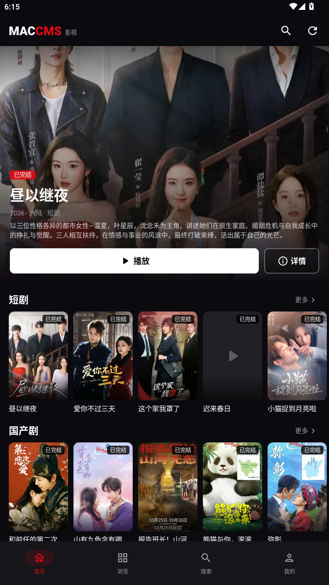
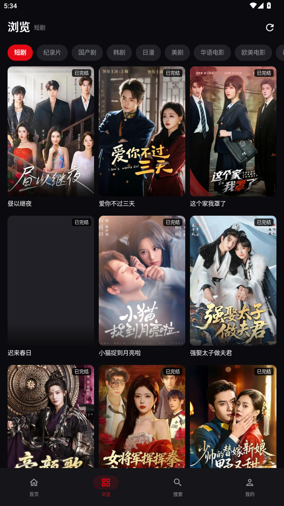
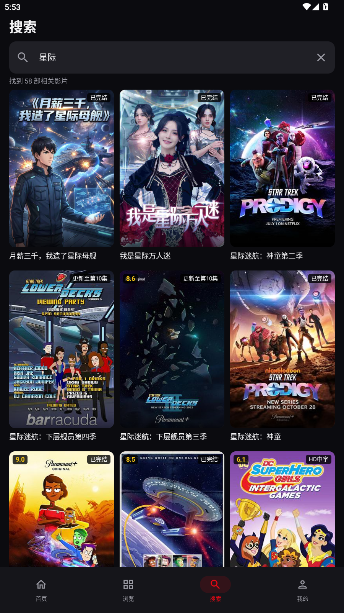
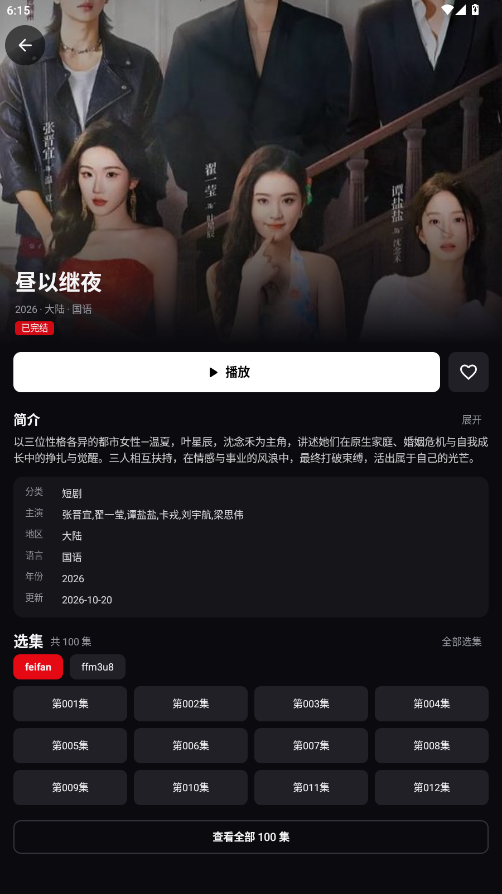
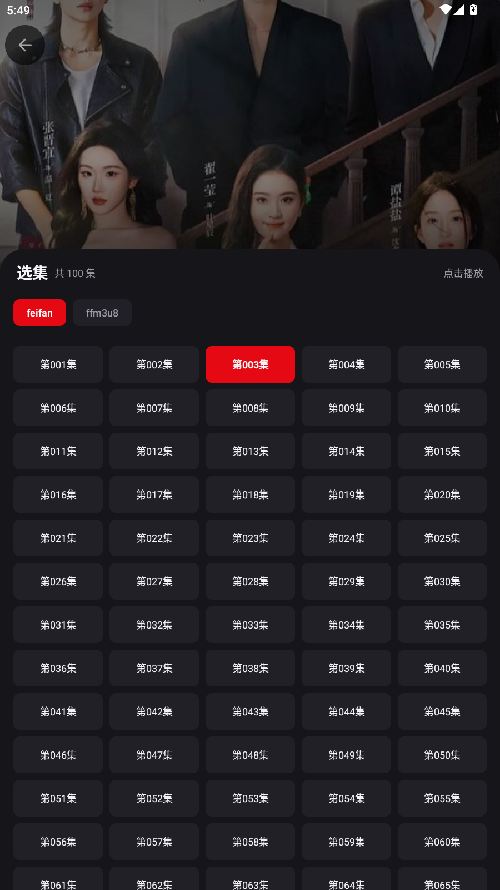
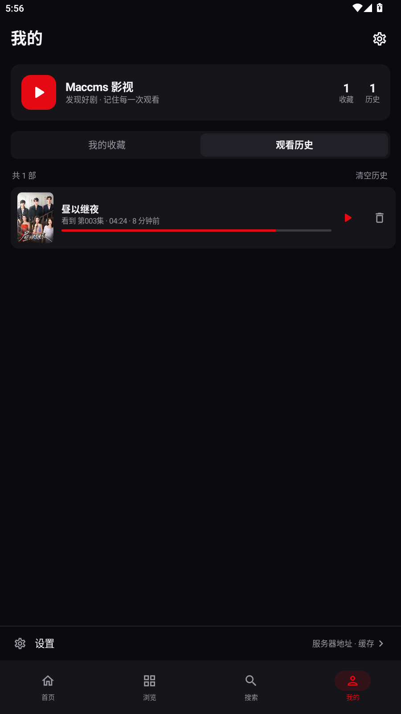
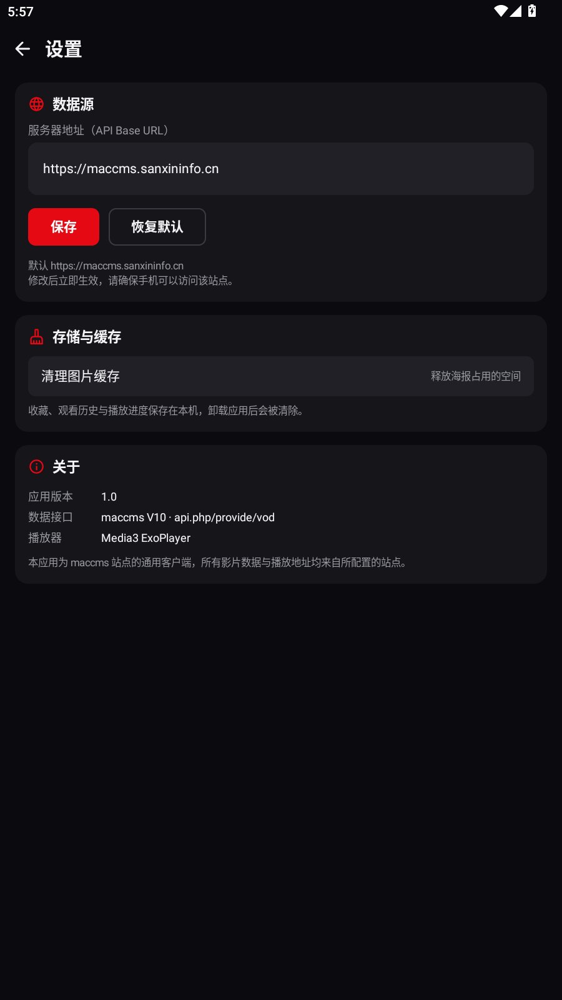

# Maccms 影视 · Android 手机客户端

基于 [`maccms-client-tv`](../maccms-client-tv) 的 TV 客户端重构的 **手机端 Android 应用**。数据源为 maccms V10 标准接口 `api.php/provide/vod`，UI 从遥控器横屏改为触控竖屏，底部导航 + 竖屏浏览 + 手势播放器，功能与 TV 端一一对应。

- 技术栈：Kotlin + Jetpack Compose（Material 3）+ Media3 ExoPlayer + Retrofit + Coil
- 包名：`com.maccms.mobile`
- 最低系统：Android 6.0（API 23），targetSdk 35
- 默认站点：`https://maccms.sanxininfo.cn`（可在设置页修改）
- 已构建 APK：仓库根目录 `maccms-mobile-debug.apk`（随仓库跟踪，可直接下载安装）
- 代码仓库（默认分支均为 `master`）：
  - Gitee（远程名 `origin`）：`git@gitee.com:shuizhuyu/maccms-android-apk.git`
  - GitHub（远程名 `github`）：`https://github.com/wtf-church/maccms-android-apk.git`
- 一键推送到两个仓库：`git pushall`（依次推送 `origin` 与 `github`）

---

## 界面预览

| 首页 | 浏览 | 搜索 |
|---|---|---|
|  |  |  |

| 详情 | 选集 | 播放器 |
|---|---|---|
|  |  |  |

| 我的（历史） | 设置 |
|---|---|
|  |  |

---

## 功能特性

### 与 TV 端对齐的全部功能

| 功能 | 说明 |
|---|---|
| 首页推荐 | Hero 大图 + 精选分类横向海报行，点击「更多」跳转到对应分类 |
| 分类浏览 | 全部分类标签 + 3 列海报网格，触底自动加载下一页 |
| 关键词搜索 | 搜索历史、结果分页、空结果/错误状态 |
| 影片详情 | 大图头部、评分/年份/地区/语言、完整简介、导演/主演、收藏、线路切换、选集 |
| 播放 | Media3 ExoPlayer，MP4 / HLS(m3u8)，多线路/多地址自动回退，HTML 分享页解析出真实 m3u8 |
| 续播 | 按「影片 + 分集」保存毫秒进度；详情页和播放页自动回到上次位置 |
| 自动连播 | 一集播完自动播放同线路下一集 |
| 观看历史 | 自动记录分集与进度，支持续播、单条删除、一键清空 |
| 我的收藏 | 详情页收藏/取消收藏，收藏列表直接进入详情 |
| 设置 | 运行时修改 API 地址、恢复默认、清理图片缓存、版本信息 |
| 富文本 | maccms 的 HTML 简介转纯文本显示 |
| 真机兼容 | 显式包含 `arm64-v8a` / `armeabi-v7a` / `x86_64`，可安装于主流手机与模拟器 |

### 手机端交互适配

- **底部导航**：首页 / 浏览 / 搜索 / 我的，替代 TV 顶部导航。
- **竖屏优先**：首页、浏览、详情、我的均为竖屏滚动；播放页自动横屏并沉浸式全屏。
- **首页「继续观看」**：从观看历史生成横向卡片，带进度条，一点即续播。
- **触控播放器**：
  - 单击显隐控件，双击左侧快退 10 秒 / 右侧快进 10 秒
  - 横滑拖动进度；左半屏竖滑调亮度，右半屏竖滑调音量
  - 底部进度条、播放/暂停、上一集/下一集、倍速（0.5x–2x）、选集
  - 底部弹层选集：线路切换 + 5 列分集网格
  - 支持音频焦点（来电/其它应用播放时自动让出）与耳机拔出暂停
- **状态保留**：首页、浏览、搜索的状态提升到 App 层，进详情/播放再返回不丢滚动位置、不重复请求。
- **刷新入口**：首页、浏览、搜索头部均提供刷新按钮。
- **横竖屏切换**：Activity 配置 `configChanges`，进入播放器横屏不会重建页面。

---

## 界面结构

```
MainActivity (edge-to-edge, 竖屏)
└─ Scaffold + 底部导航（仅一级页面显示）
   └─ NavHost
      ├─ home      首页：Hero + 继续观看 + 精选分类
      ├─ browse    浏览：分类标签 + 3 列网格 + 触底分页
      ├─ search    搜索：搜索框 + 历史 + 结果网格
      ├─ library   我的：收藏 / 历史双 Tab + 设置入口
      ├─ settings  设置
      ├─ detail/{vodId}                详情（隐藏底部栏）
      └─ player/{vodId}?episode=...    播放（横屏、沉浸式）
```

---

## 与 TV 版的主要差异

| 维度 | TV 版 | 手机版 |
|---|---|---|
| 导航 | 顶部横向导航 + 遥控焦点 | 底部 Tab + 触控 |
| 布局 | 横屏 16:9，5 列网格 | 竖屏，3 列网格，大图头部 |
| 播放控件 | D-pad 焦点 + 官方 Media3 Compose 控件 | 自定义触控层 + PlayerView |
| 选集 | 方向键游标 8×3 面板 | BottomSheet 5 列网格 |
| 进度/历史 | 相同 | 相同（存储键名改为 `maccms_mobile_*`，与 TV 版互不干扰） |
| 首页分类 | 逐分类探测为空则隐藏 | 精选 10 个分类，减少首屏请求 |

---

## 开发说明

架构速查、构建/测试命令、交互约定与容易踩的坑（协程取消、列表滚动挂起、播放器音频焦点等）见 [CLAUDE.md](CLAUDE.md)。新增功能时请保持 TV 端已有功能在手机端的完整对应。

---

## 构建

### 方式一：Docker（与本仓库一致的构建环境）

构建镜像基于 TV 项目的 `docker-build:latest`，额外安装 Android SDK Platform 36 / Build-Tools 36：

```bash
docker build -t maccms-mobile-build docker

# 构建 debug APK
bash scripts-build.sh
# 产物：app/build/outputs/apk/debug/app-debug.apk
```

> 构建使用仓库内固定的调试签名 `keystore/debug.keystore`（标准 Android debug key，口令 `android`），
> 因此多次 Docker 构建的 APK 可以直接覆盖安装，不会出现签名不一致。

### 方式二：本机 Android Studio

1. 使用 Android Studio 打开本目录。
2. 安装 Android SDK Platform 36、Build-Tools 36.0.0。
3. 直接 Run `app`，或执行：

```bash
./gradlew :app:assembleDebug
```

> Gradle 8.11.1 + AGP 8.7.3 + Kotlin 2.2.10，仓库源已配置阿里云镜像。

---

## 安装与验证

```bash
adb install -r app/build/outputs/apk/debug/app-debug.apk
adb shell am start -n com.maccms.mobile/.MainActivity
```

已在 Android 12 x86_64 模拟器（900×1600）上完成以下验证：

- 首页加载真实 API 数据、海报与 Hero 展示正常
- 浏览页分类切换、网格加载、触底分页
- 详情页完整信息、收藏、线路/选集
- 播放器横屏、进度续播、自动连播、选集弹层
- 搜索历史、搜索结果与分页
- 我的收藏 / 观看历史 / 设置

---

## 项目结构

```
app/src/main/java/com/maccms/mobile/
├─ MainActivity.kt          # 导航、底部栏、横竖屏
├─ MaccmsApp.kt             # Application + Coil 图片缓存
├─ data/
│  ├─ ApiClient.kt          # Retrofit + maccms API，地址变更自动重建
│  ├─ Models.kt             # Vod / ApiResponse / 播放地址解析
│  ├─ VodRepository.kt      # 列表、搜索、详情 + 跨页快照缓存
│  └─ Categories.kt         # 默认站点分类
├─ util/
│  ├─ BaseUrlManager.kt     # API 地址持久化
│  ├─ FavoriteStore.kt      # 收藏
│  ├─ WatchHistoryStore.kt  # 观看历史
│  ├─ PlaybackStore.kt      # 分集播放进度/续播
│  ├─ SearchHistoryStore.kt # 搜索历史
│  ├─ RichTextParser.kt     # HTML 简介转文本
│  └─ Formatters.kt         # 时间格式化
└─ ui/
   ├─ theme/                # 深色观影主题
   ├─ components/           # 海报卡、继续观看、选集网格/弹层、状态页
   ├─ home/                 # 首页
   ├─ browse/               # 浏览
   ├─ search/               # 搜索
   ├─ library/              # 我的（收藏/历史）
   ├─ detail/               # 详情
   ├─ player/               # 播放器
   └─ settings/             # 设置
```

---

## 说明

- 分类 ID 按默认站点 `maccms.sanxininfo.cn` 配置；如切换到其它 maccms 站点，分类名称/ID 可能需要在 `data/Categories.kt` 调整，搜索、详情、播放不受影响。
- 应用允许明文 HTTP（`usesCleartextTraffic=true`），便于在局域网自建站点上测试；正式使用建议配置 HTTPS。
- 播放器请求头默认携带浏览器 UA 与当前站点 Referer，降低 CDN 防盗链导致的播放失败概率。
- 所有收藏、历史、进度仅保存在本机 SharedPreferences，不上传任何服务器。

## 常见问题

**首页/浏览一直显示“加载中”怎么办？**
先确认手机能访问当前 Base URL；在「我的 → 设置」检查服务器地址，返回首页点右上角刷新。若切换到其它 maccms 站点，分类 ID 可能不同（见下一条）。

**分类为空或分类名称不对？**
分类 ID/名称按默认站点 `maccms.sanxininfo.cn` 写在 `data/Categories.kt`。访问其它站点时请按该站点的实际分类调整；搜索、详情、播放不依赖这份列表。

**播放失败 / 一直缓冲？**
优先在播放页「选集」里切换线路或集数；客户端会按候选地址自动回退，并对 HTML 分享页提取真实 m3u8。部分源存在时效性或防盗链限制，换线路通常可解决。

**安装时报 `INSTALL_FAILED_UPDATE_INCOMPATIBLE`？**
设备上已有使用其它签名安装的同包名应用。执行 `adb uninstall com.maccms.mobile` 后重新安装；之后仓库内固定签名可正常覆盖升级。

**修改服务器地址后列表还是旧数据？**
列表有本地状态缓存，返回首页/浏览页点击刷新按钮即可重新请求。

**字幕/清晰度在哪里切换？**
当前跟随片源本身（含内嵌字幕），客户端未做独立字幕轨与清晰度选择。

**收藏、历史、进度存在哪里？**
全部保存在本机 SharedPreferences，卸载应用即清除；不会上传到任何服务器。

---

## 版本记录

### v1.0 — 2026-10-21

- 手机端首个完整版本，1:1 移植 TV 端功能：首页、分类浏览、搜索、详情、线路/选集、播放、续播、自动连播、收藏、观看历史、设置。
- 手机交互适配：底部导航、竖屏 3 列布局、首页「继续观看」、手势播放器（单击显隐 / 双击快进退 / 横滑进度 / 竖滑亮度音量）、倍速、BottomSheet 选集。
- 播放器支持音频焦点、耳机拔出暂停、多地址回退、HTML 分享页 m3u8 解析。
- 固定调试签名，Docker 多次构建可覆盖安装；APK 含 `arm64-v8a` / `armeabi-v7a` / `x86_64`。
- 已在 Android 12 x86_64 模拟器连接线上 maccms 站点完成端到端验证。

---

## 许可证

客户端代码仅用于个人学习与自建 maccms 站点访问。影片数据、海报与播放地址版权归原站点及权利人所有。
